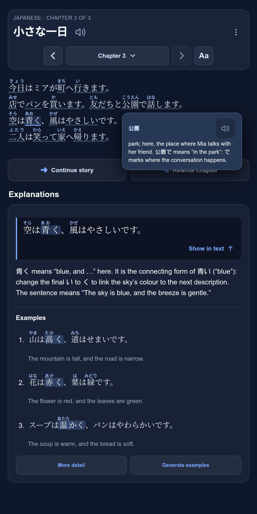

# LingoMage — Learn languages through stories

**Turn the words and ideas you want to practise into stories you want to read.** LingoMage creates AI stories for learners of German, Japanese, Russian and Spanish, with English explanations, adjustable difficulty and Short/Medium/Long chapters.

LingoMage is an **[App²](https://github.com/javiercmh/appapp) subapp**: it runs inside App² on Android and uses its shared AI connection.



*Japanese reading mode with sample text from the offline browser preview.*

## What you can do

- **Make it personal:** choose a topic, vocabulary, difficulty and language preferences.
- **Read comfortably:** adjust text size, toggle Japanese furigana and open word notes when needed.
- **Get contextual help:** select a passage and tap Explain for its English meaning and usage.
- **Shape the story:** add chapters with follow-up prompts or rewrite a chapter while keeping the original.
- **Read again offline:** save stories and explanations in your workspace.

## Get started

1. In App², tap **Import** and paste `https://github.com/javiercmh/lingomage`.
2. Connect an AI provider in the App² library under **Settings → AI**.
3. Open LingoMage, choose your language and model, and generate a story.

Difficulty and explanations are AI estimates, not certified proficiency assessments.

## For developers

Plain HTML, CSS and JavaScript; no dependencies or build step. Preview with Python 3.9+:

```sh
python3 dev_server.py --mock-ai
```

Open [localhost:8888](http://localhost:8888). The mock is offline; the server writes workspace files, so use a disposable copy for testing.

For live desktop testing, sign in with the Codex CLI and run:

```sh
codex login
python3 dev_server.py --chatgpt
```

This development-only connection uses the model catalog and ChatGPT account managed by Codex. Requests may count against your ChatGPT plan. Codex is required; the Python server stores no credentials. Each request uses a fresh temporary directory and ephemeral Codex thread. Pending requests are lost if the server stops. Use a disposable copy for testing because workspace files are saved by the server.

See the [runtime guide](docs/architecture/app2-runtime.md) and [pedagogical decisions](docs/pedagogy/README.md). The native app has been retired; historical Kotlin is preserved in Git. See the [safeguard audit](docs/architecture/language-safeguards.md).

Run `python3 scripts/check.py` with Node.js 22 and Python 3.9+ for the full regression, server and manifest checks. CI runs the same command; the released subapp still has no dependencies or build step. Unfinished generation is saved in inspectable JSON and offers explicit Resume/Discard recovery.
