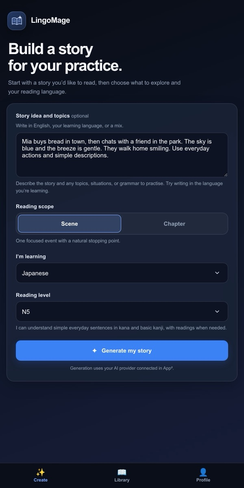
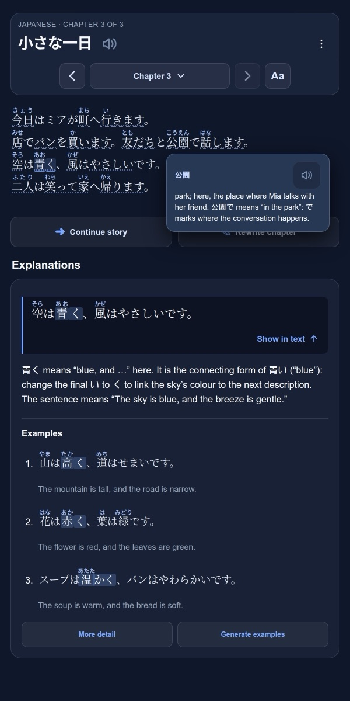

# LingoMage

**Learn a language by reading stories made for you.** Pick what the story is about and the words you want to practise. LingoMage writes it at your reading level, with English help whenever you need it.

Supports **German, Japanese, Russian and Spanish**. LingoMage runs inside [App²](https://github.com/javiercmh/appapp) on Android.

<p align="center">
  
  
</p>
<p align="center"><sub><b>Create a story</b> · <b>Read with help</b></sub></p>

## Get started

1. Install [App²](https://github.com/javiercmh/appapp/releases/latest).
2. In App², tap **New app** and paste `https://github.com/javiercmh/lingomage`.
3. Connect an AI provider in App² under **Settings → AI**.
4. Open LingoMage, set your languages and levels in **Profile**, and create your first story.

## What you can do

| | |
| :--- | :--- |
| ✍️ **Make it personal** | Choose the story idea, practice topics, reading level and length. |
| 📖 **Read comfortably** | Change text size, show Japanese furigana and open word notes. |
| 💡 **Get explanations** | Select any passage and tap **Explain** for its meaning and usage. |
| ➕ **Continue the story** | Add chapters or rewrite one while keeping the original. |
| 🔁 **Review your lookups** | See the words you look up most, with every meaning and sentence. |
| 📴 **Read offline** | Stories and explanations are saved on your phone. |

Reading levels are targets you choose, not official assessments.

## For developers

Plain HTML, CSS and JavaScript, with no build step. To preview in your browser (Python 3.9+), run:

```sh
python3 dev_server.py --mock-ai
```

Then open [localhost:8888](http://localhost:8888). Your test stories and settings are kept in `.dev-data/`, which Git ignores. To run all checks (also needs Node.js 22.12+):

```sh
python3 scripts/check.py
```

Contributors and coding agents start with [AGENTS.md](AGENTS.md). See also the [pedagogical decisions](docs/pedagogy/README.md).
